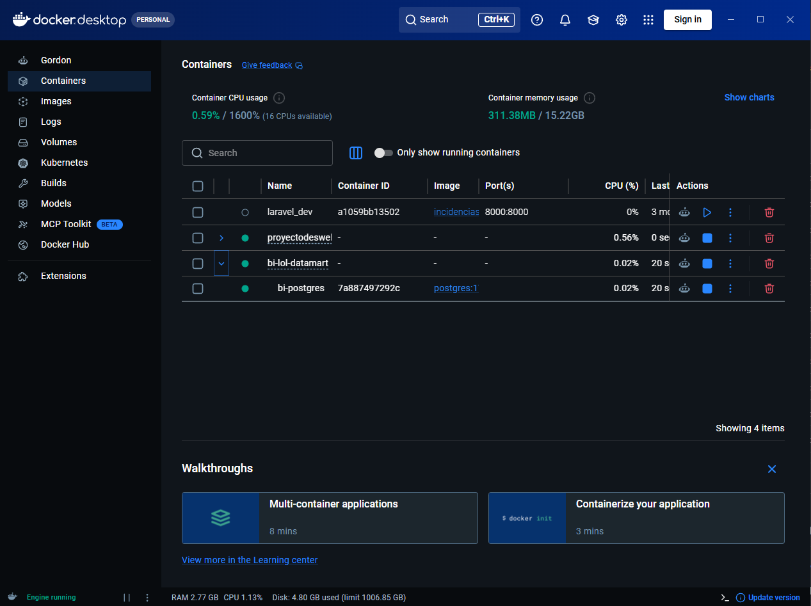
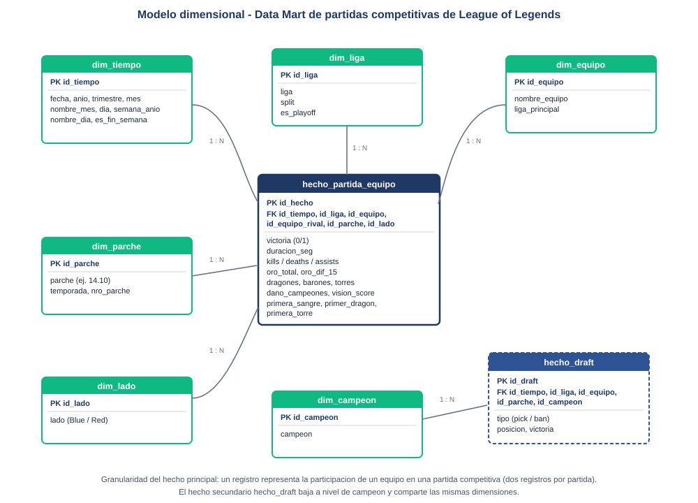

# Data Mart — League of Legends competitivo 2024

Proyecto de la asignatura **Inteligencia de Negocios** (UPSE, Carrera de Ingeniería de Software).

Solución de Business Intelligence de extremo a extremo sobre partidas competitivas de
League of Legends 2024 (Oracle's Elixir, publicado en Kaggle): limpieza con Python,
Data Mart en PostgreSQL, vistas y funciones SQL, y dashboard en Streamlit.

```
Kaggle (.xlsx) → 02_limpieza.py → PostgreSQL (esquema dm) → vistas / funciones → app/app.py (Streamlit)
```

**Autora:** Diana Lucía Melena Santander

- **Documento final:** [docs/entregable3/Entregable3_Dashboard_LoL.pdf](docs/entregable3/Entregable3_Dashboard_LoL.pdf)
- **Video de presentación:** https://drive.google.com/file/d/1rPyXhh2Nnhdeo60MUhU4wRjrCm_YOu63/view?usp=sharing

---

## Dataset

- **Fuente:** [League of Legends 2024 Competitive Game dataset](https://www.kaggle.com/datasets/barthetur/league-of-legends-2024-competitive-game-dataset) (Kaggle)
- **Origen primario:** [Oracle's Elixir](https://oracleselixir.com)
- **Archivo:** `2024_LoL_esports_match_data_from_OraclesElixir.xlsx` — 12 276 filas, 123 columnas
- **Período:** 1 de enero al 13 de febrero de 2024 (1 023 partidas, 28 ligas)
- **Granularidad original:** 12 filas por partida (10 de jugador y 2 de resumen por equipo)

---

## Requisitos

- Docker y Docker Compose
- Python 3.10 o superior: `pip install -r requirements.txt`

---

## Puesta en marcha

```bash
# 1. Levantar PostgreSQL 17
docker compose up -d

# 2. Limpiar el dataset y generar los CSV de carga (se ejecuta en el host)
python 02_limpieza.py

# 3. Crear el modelo dimensional
docker compose exec postgres psql -U bi_user -d bi_database -f /proyecto/01_modelo.sql

# 4. Cargar los datos
docker compose exec postgres psql -U bi_user -d bi_database -f /proyecto/03_carga.sql

# 5. Validar la carga
docker compose exec postgres psql -U bi_user -d bi_database -f /proyecto/04_validaciones.sql

# 6. Crear vistas y funciones
docker compose exec postgres psql -U bi_user -d bi_database -f /proyecto/05_vistas_funciones.sql

# 7. Abrir el dashboard (http://localhost:8501)
streamlit run app/app.py
```

> El contenedor publica PostgreSQL en el puerto **5433** del equipo para no chocar con un
> PostgreSQL instalado localmente. La app usa `PGHOST`, `PGPORT`, `PGDATABASE`, `PGUSER` y
> `PGPASSWORD` si están definidas; si no, los valores de la tabla de conexión.

Para apagar el entorno: `docker compose down`
(los datos persisten en el volumen `postgres_data`; usar `down -v` para borrarlos).

Contenedor `bi-postgres` en ejecución dentro del proyecto `bi-lol-datamart`:



### Conexión

| Parámetro | Valor |
|---|---|
| Host | localhost |
| Puerto | 5433 (el contenedor usa 5432 internamente) |
| Base de datos | bi_database |
| Usuario | bi_user |
| Contraseña | bi_password |
| Esquema | dm |

---

## Estructura del repositorio

```
.
├── docker-compose.yml        Contenedor de PostgreSQL 17
├── 01_modelo.sql             Esquema dm: dimensiones, hechos, PK, FK e índices
├── 02_limpieza.py            Limpieza del Excel de Kaggle y generación de los CSV de carga
├── 03_carga.sql              Staging, \copy y poblado del modelo
├── 04_validaciones.sql       Conteos, integridad, nulos, totales y coherencia con el origen
├── 05_vistas_funciones.sql   5 vistas y 3 funciones para el dashboard
├── requirements.txt          Dependencias de Python
├── app/
│   └── app.py                Dashboard Streamlit conectado a PostgreSQL
├── assets/
│   └── diagrama_estrella.svg Diagrama del modelo dimensional
├── dashboard/                Mockup del dashboard (HTML, CSS y JS)
│   ├── index.html
│   ├── styles.css
│   └── app.js
├── docs/                     Documentos de los entregables (Word y PDF)
└── capturas/                 Evidencias de ejecución
```

---

## Dashboard (Streamlit)

`app/app.py` lee **solo de PostgreSQL** (vistas `vw_partidas`, `vw_draft` y la función
`fn_evolucion_equipo`); nunca lee el archivo original.

- **Filtros:** liga, split, rango de fechas, parche y mínimo de partidas. Se pasan como
  parámetros SQL, así que recalculan cada consulta.
- **Pestañas:** Vista general (3 KPI, barras y líneas), Metajuego, Equipo y Detalle de partidas.

El mockup previo (Entregable 2) sigue publicado en GitHub Pages:
https://misstery13.github.io/bi-lol-datamart/dashboard/

---

## Evidencias de ejecución

| Captura | Contenido |
|---|---|
| [docker_contenedor.png](capturas/docker_contenedor.png) | Contenedor `bi-postgres` en Docker Desktop |
| [01_limpieza.png](capturas/01_limpieza.png) | Salida de `02_limpieza.py` |
| [02_carga.png](capturas/02_carga.png) | Salida de `03_carga.sql` |
| [03_validaciones_conteo_integridad.png](capturas/03_validaciones_conteo_integridad.png) | Validaciones V1 a V3 |
| [04_validaciones_nulos_totales.png](capturas/04_validaciones_nulos_totales.png) | Validaciones V4 y V5 |
| [05_vistas_funciones.png](capturas/05_vistas_funciones.png) | Consultas a vistas y funciones |
| [06_validacion_coherencia.png](capturas/06_validacion_coherencia.png) | Validación V6: origen vs. cargado |
| [07_app_vista_general.png](capturas/07_app_vista_general.png) | Streamlit: vista general (LCK, LPL, LEC, LCS) |
| [08_app_filtro_lck.png](capturas/08_app_filtro_lck.png) | Streamlit: mismos componentes filtrando solo LCK |
| [09_app_metajuego.png](capturas/09_app_metajuego.png) | Streamlit: pestaña Metajuego |
| [10_app_equipo.png](capturas/10_app_equipo.png) | Streamlit: pestaña Equipo |
| [11_app_detalle.png](capturas/11_app_detalle.png) | Streamlit: pestaña Detalle de partidas |

---

## Modelo dimensional



**Granularidad del hecho principal:** un registro de `hecho_partida_equipo` representa
la participación de un equipo en una partida competitiva (dos registros por partida).

| Objeto | Tipo |
|---|---|
| `dim_tiempo` | Dimensión — un registro por día |
| `dim_liga` | Dimensión — liga, split y fase |
| `dim_equipo` | Dimensión |
| `dim_parche` | Dimensión — versión del juego |
| `dim_lado` | Dimensión — lado azul o rojo |
| `dim_campeon` | Dimensión |
| `hecho_partida_equipo` | Hechos — equipo por partida |
| `hecho_draft` | Hechos — campeón elegido o baneado por equipo y partida |

---

## KPI

| KPI | Objeto SQL |
|---|---|
| Tasa de victoria | `vw_partidas`, `vw_kpi_equipo`, `fn_tasa_victoria()` |
| Victorias con ventaja de oro al minuto 15 | `vw_partidas`, `vw_ventaja_temprana` |
| Presencia en el draft | `vw_draft`, `vw_presencia_campeon`, `fn_top_campeones()` |

---

## Nota académica

Trabajo desarrollado con fines educativos. Los datos pertenecen a Oracle's Elixir y
League of Legends es una marca registrada de Riot Games.
